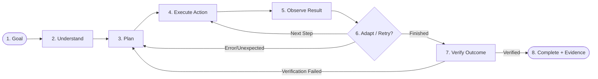

# CentrAlign AI — Autonomous AI Employee Prototype
## Comprehensive Engineering Implementation Plan (`plan.md`)

---

## 1. Executive Summary & Problem Understanding

### 1.1 Context & Objective
CentrAlign AI is building the next generation of **autonomous AI employees** for enterprises. Unlike conversational assistants that simply answer questions or provide suggestions, an AI employee must:
- Take high-level business goals and independently figure out the necessary actions.
- Navigate disparate company environments (browser portals, file systems, APIs, internal databases).
- Observe results, handle unpredictable failures gracefully, and maintain context across multi-step execution.
- Request human approval only when safety thresholds or permissions require it.
- **Formally verify** that the requested outcome was actually completed and supply verifiable audit evidence.

### 1.2 The Core Execution Loop
The system is architected around CentrAlign's designated execution lifecycle:


---

## 2. Target Business Scenario: Autonomous Multi-System Operations Worker

To provide a concrete, fully demonstrable, and genuinely working prototype (rather than a wide, shallow simulation), the system will implement an end-to-end enterprise workflow:

### **Autonomous Invoice Processing, Audit & ERP Reconciliation Worker**
- **User Request Example:**
  > *"Find the latest Q3 vendor invoices in the incoming repository, extract the amounts and line items, reconcile them against our vendor purchase orders in the internal portal, submit the verified records into our ERP accounting portal, and alert me with an audit trail once done."*
- **Why this demonstrates full autonomy:**
  1. **Disparate Tools:** Involves PDF/document file parsing, browser interaction with a web-based company portal, data validation, and database updates.
  2. **Non-Trivial Reasoning & Adaptation:** Handles ambiguous file formats, detects mismatches between invoice and PO, retries on form submission glitches, and handles pagination.
  3. **Human-in-the-Loop (HITL) Gates:** If an invoice amount exceeds an enterprise approval threshold (e.g., > $5,000) or vendor bank details mismatch, the agent pauses and triggers a formal human approval request with context.
  4. **Strict Verification:** Agent checks that the record was persisted in the ERP database, captures a visual screenshot of the confirmation page, and outputs a structured evidence package.

---

## 3. Technology Stack & Service Architecture

### 3.1 LLM & Inference Engine
- **Primary Model:** `openai/gpt-oss-120b` served via **Groq Cloud API**.
  - **Rationale:** 120B open-weight Mixture-of-Experts model running at ~500 tokens/second on Groq LPUs. Provides sub-second reasoning loops, native function calling/structured output, and a 131k token context window at free/ultra-low tier.
  - **Fallback / Alternative Model:** `llama-3.3-70b-versatile` / `llama-3.1-8b-instant` via Groq (configured seamlessly via environment variables).

### 3.2 Embedding & Retrieval System
- **Model:** `BAAI/bge-small-en-v1.5` or `sentence-transformers/all-MiniLM-L6-v2` via **FastEmbed** or **HuggingFace Sentence-Transformers**.
  - **Rationale:** 100% local, high-speed CPU embedding (zero external API cost, zero rate limits, completely offline-compatible).
- **Vector Storage:** **ChromaDB** (local persistent mode) or SQLite with vector indexing for episodic memory, company policy manuals, and past execution runbooks.

### 3.3 Core Runtime & Agent Orchestration
- **Runtime:** Python 3.11+ (Asyncio-native).
- **Orchestration:** Deterministic Finite State Machine (FSM) / Graph-based Agent Runtime (custom lightweight event-driven state machine or LangGraph engine with strict Pydantic v2 schemas).
- **Validation:** **Pydantic v2** for all tool inputs, step observations, plan structures, and verification assertions.

### 3.4 Browser Automation & Computer Use
- **Engine:** **Playwright (Python Async)**.
  - **Capabilities:** Headless/Headed browser control, semantic DOM extraction, accessibility tree snapshotting, locator-based actions (click, fill, select, upload), error boundary capturing, and screenshot generation for visual verification.

### 3.5 Simulated Enterprise Applications (Sandbox)
- **Local ERP / Portal:** A lightweight **FastAPI + Jinja2/HTML5** application simulating a real enterprise accounting/ticketing system with:
  - User authentication and role-based forms.
  - Table listings, search, pagination, and submission endpoints.
  - Edge cases: Simulated temporary network dropouts, duplicate detection, and form validation errors to prove agent self-healing.
- **Local File Repository:** A mock company filesystem containing incoming invoices (PDFs, CSVs, TXT), vendor contracts, and purchase order registries.

### 3.6 Observation Console & UI
- **Live Agent Dashboard:** Real-time web UI (FastAPI + SSE / WebSocket + Vanilla CSS/Tailwind) displaying:
  - Current Agent Goal & Plan steps.
  - Live execution trace with thought process and tool inputs/outputs.
  - Embedded browser screenshot stream showing agent's active viewport.
  - Interactive Human-in-the-Loop approval modal (Approve / Reject / Provide Guidance).
  - Final Verification & Audit Evidence viewer.
- **Terminal CLI:** Rich-based interactive terminal runner with colorized execution progress and step inspection.

---

## 4. Project Directory Structure

```
CentrAlign/
├── .env.example                     # Groq API key, environment configs
├── README.md                        # Setup, architectural overview, usage, run guides
├── decisions.md                     # Architecture Decision Record (ADR) updated per step
├── plan.md                          # This master engineering plan
├── pyproject.toml / requirements.txt# Project dependencies
│
├── core/                            # Core Autonomous Agent Runtime
│   ├── __init__.py
│   ├── config.py                    # Environment settings, model configs
│   ├── state.py                     # State definitions (AgentState, Goal, ExecutionTrace)
│   ├── engine.py                    # Main agent execution loop (Goal -> Complete)
│   ├── planner.py                   # Deconstructs goal into dynamic plan & milestones
│   ├── observer.py                  # Evaluates tool outputs, state mutations, errors
│   ├── adapter.py                   # Failure recovery, replanning, retry strategy
│   ├── verifier.py                  # Independent outcome verification engine
│   └── hitl.py                      # Human-in-the-Loop approval protocol
│
├── llm/                             # LLM and Embedding Providers
│   ├── __init__.py
│   ├── groq_client.py               # Groq client wrapper for openai/gpt-oss-120b
│   ├── embeddings.py                # Local FastEmbed / Sentence-Transformers
│   └── prompts.py                   # System prompts for planning, acting, self-reflection
│
├── memory/                          # Context, Episodic & Knowledge Systems
│   ├── __init__.py
│   ├── working_memory.py            # In-run scratchpad, step context & trace
│   ├── episodic_memory.py           # ChromaDB store for past runs & error resolutions
│   └── company_context.py           # Company policies, schemas, and credentials rules
│
├── tools/                           # Tool Registry & Implementations
│   ├── __init__.py
│   ├── base.py                      # BaseTool class with Pydantic schema validation
│   ├── registry.py                  # Tool discovery, permissions & invocation router
│   ├── browser/                     # Playwright automation tools
│   │   ├── __init__.py
│   │   ├── browser_tool.py          # Navigate, click, fill, extract, screenshot
│   │   └── dom_parser.py            # Converts page to clean, token-efficient DOM representation
│   ├── filesystem/                  # File operations
│   │   ├── __init__.py
│   │   └── file_tool.py             # Read, write, parse PDFs, CSVs, JSON
│   └── system/                      # Auxiliary utilities
│       ├── __init__.py
│       └── calculator.py            # Deterministic math & reconciliation validator
│
├── sandbox/                         # Simulated Enterprise Environment
│   ├── __init__.py
│   ├── erp_app.py                   # FastAPI mock ERP portal (Accounts Payable / POs)
│   ├── data/                        # Mock data (Sample Invoices, PO registry, contracts)
│   └── templates/                   # HTML templates for the mock ERP interface
│
├── server/                          # Agent Server & Real-time Live UI
│   ├── __init__.py
│   ├── app.py                       # FastAPI server serving API, SSE & web UI
│   ├── events.py                    # Event broker for streaming agent actions
│   └── static/                      # Modern, sleek UI for live execution viewing
│       ├── index.html
│       ├── app.js
│       └── style.css
│
├── cli/                             # Terminal Runner
│   ├── __init__.py
│   └── main.py                      # Typer/Rich CLI interface
│
└── tests/                           # Comprehensive Test Suite
    ├── __init__.py
    ├── conftest.py                  # Fixtures for mock LLM, browser, and sandbox
    ├── unit/                        # Fast unit tests for individual components
    │   ├── test_groq_client.py
    │   ├── test_planner.py
    │   ├── test_tools.py
    │   ├── test_memory.py
    │   └── test_verifier.py
    ├── integration/                 # Multi-component interaction tests
    │   ├── test_browser_automation.py
    │   ├── test_sandbox_erp.py
    │   └── test_hitl_flow.py
    └── e2e/                         # Complete autonomous task benchmarks
        ├── test_invoice_reconciliation_e2e.py
        └── test_failure_recovery_e2e.py
```

---

## 5. Detailed Step-by-Step Implementation Phases

Every phase below includes:
1. **Deliverables & Tasks**
2. **Mandatory Testing Criteria (Executed after step completion)**
3. **`decisions.md` Update Requirements**

---

### **Phase 1: Environment Setup, Configuration & LLM Integration**
- **Objective:** Establish the foundation, configure Groq with `openai/gpt-oss-120b`, set up local embeddings, and implement foundational schemas.
- **Tasks:**
  1. Initialize Python virtual environment with dependencies (`groq`, `pydantic`, `fastapi`, `uvicorn`, `playwright`, `chromadb`, `pytest`, `rich`, `pypdf`).
  2. Implement `core/config.py` supporting environment loading, Groq API keys, model selections (`openai/gpt-oss-120b`), and runtime parameters.
  3. Implement `llm/groq_client.py` with structured JSON output, tool-calling handling, token budgeting, and automatic retry on rate-limiting.
  4. Implement `llm/embeddings.py` for local embeddings using FastEmbed or HuggingFace (`all-MiniLM-L6-v2`).
  5. Implement `core/state.py` defining standard Pydantic models for `Goal`, `TaskPlan`, `ActionStep`, `Observation`, and `ExecutionTrace`.
- **Testing Requirements:**
  - `pytest tests/unit/test_groq_client.py`: Test Groq connectivity, structured response parsing, tool-call formatting, and error handling.
  - `pytest tests/unit/test_embeddings.py`: Verify embedding generation dimensions and deterministic vector generation.
- **Decisions Record (`decisions.md`):** Document choice of `openai/gpt-oss-120b` on Groq, token efficiency strategies, embedding model selection, and Pydantic v2 schema architecture.

---

### **Phase 2: Enterprise Sandbox Environment (Mock ERP & Files)**
- **Objective:** Build a realistic, self-contained enterprise application for the agent to manipulate without external security risks or flakey third-party services.
- **Tasks:**
  1. Build `sandbox/erp_app.py` using FastAPI:
     - Login page (`/login`) with session cookies.
     - Purchase Orders table (`/purchase-orders`) with search and status flags.
     - Invoice Submission form (`/invoices/new`) with fields: Vendor Name, PO Number, Invoice Date, Line Items, Total Amount, Tax, and Approval Status.
     - Intentional Chaos Modes: Toggleable flags to simulate flaky network (500 errors), validation rejections, or dynamic DOM changes.
  2. Populate `sandbox/data/` with:
     - 3 realistic vendor invoice files (PDF and text format) with varying layouts.
     - A database/JSON store of open Purchase Orders with varying authorization thresholds.
- **Testing Requirements:**
  - `pytest tests/integration/test_sandbox_erp.py`: Verify that the mock ERP launches, accepts authentication, serves data, processes invoice submissions, and throws expected validation errors.
- **Decisions Record (`decisions.md`):** Document why an internal sandbox environment was chosen over mocked API stubs (realistic DOM tree, genuine browser clicks, accurate end-to-end evaluation).

---

### **Phase 3: Tool Abstractions & Playwright Browser Automation**
- **Objective:** Develop robust, error-resilient tool interfaces and browser computer-use capabilities.
- **Tasks:**
  1. Implement `tools/base.py` and `tools/registry.py`:
     - Strongly typed tool signature using Pydantic parameters and return types.
     - Tool execution sandboxing, timeout management, and structured error propagation.
  2. Implement `tools/browser/browser_tool.py`:
     - Headless / headed Playwright instance management.
     - Actions: `navigate(url)`, `click(selector_or_text)`, `type(selector, text)`, `select_option(selector, value)`, `extract_text()`, `take_screenshot(filename)`.
     - Smart waiting: dynamic element stabilization to avoid race conditions.
  3. Implement `tools/browser/dom_parser.py`:
     - Clean DOM distillation: converts full HTML into a compact, accessible representation (interactable element map with IDs: `[#btn-submit] Submit Invoice`, `[#input-po] PO Number`) to minimize token consumption for the LLM.
  4. Implement `tools/filesystem/file_tool.py`:
     - Safe file reader for PDF invoices (text extraction via `pypdf`), CSVs, and TXT files.
  5. Implement `tools/system/calculator.py`:
     - Deterministic arithmetic tool to verify tax, totals, and line item sums without LLM math hallucination.
- **Testing Requirements:**
  - `pytest tests/integration/test_browser_automation.py`: Test navigating to the sandbox ERP, filling forms, reading tables, capturing screenshots, and handling missing selectors.
  - `pytest tests/unit/test_tools.py`: Test file extraction from sample PDF invoices and math verification tools.
- **Decisions Record (`decisions.md`):** Document DOM simplification strategy vs full HTML dumping (token savings, accuracy), and locator strategy (accessibility role & text over brittle XPath).

---

### **Phase 4: Autonomous Core Loop & State Machine**
- **Objective:** Implement the core agent loop (**Goal → Understand → Plan → Execute → Observe → Adapt → Verify → Complete**).
- **Tasks:**
  1. Implement `core/planner.py`:
     - Takes a high-level natural language goal.
     - Generates structured milestones and an initial plan.
     - Dynamically updates plan status (`pending`, `in_progress`, `completed`, `failed`, `skipped`).
  2. Implement `core/engine.py`:
     - Main execution cycle that selects the next tool call based on current plan, recent observations, and company policies.
     - Prevents infinite loops via step budget and cycle detection.
  3. Implement `core/observer.py`:
     - Interprets the output of executed tools.
     - Extracts key state facts into `working_memory`.
  4. Implement `core/adapter.py` (Self-Correction & Recovery):
     - If an action fails (e.g., form validation failed, button not found, data format error), the adapter analyzes the error, adjusts the plan, and attempts an alternative strategy without dying.
- **Testing Requirements:**
  - `pytest tests/unit/test_planner.py`: Verify that complex goals produce valid, executable milestone plans.
  - `pytest tests/integration/test_failure_recovery_e2e.py`: Simulate an intentional form error (e.g. wrong date format); verify agent reads the error message, reformats the date, and resubmits successfully.
- **Decisions Record (`decisions.md`):** Document deterministic state machine vs pure LLM free-wheeling; error recovery tactics; cycle detection thresholds.

---

### **Phase 5: Memory System, Policy Engine & Human-in-the-Loop (HITL)**
- **Objective:** Empower the agent with episodic memory of company procedures and safe human escalation.
- **Tasks:**
  1. Implement `memory/working_memory.py`: In-memory scratchpad tracking discovered entity IDs, current active invoice, extracted totals, and action history.
  2. Implement `memory/episodic_memory.py`: ChromaDB integration to store past execution traces, schema quirks, and learned guidelines.
  3. Implement `core/hitl.py` (Human-in-the-Loop):
     - Defines clear trigger rules (e.g., invoice total > $5,000, new vendor never seen before, or 3 consecutive failed recovery attempts).
     - Halts execution, formats an actionable approval request with rationale, options (Approve / Reject / Input Correction), and waits for human input.
- **Testing Requirements:**
  - `pytest tests/integration/test_hitl_flow.py`: Test that an invoice exceeding $5,000 automatically triggers the HITL pause, and that providing human approval resumes execution to completion.
  - `pytest tests/unit/test_memory.py`: Verify vector storage, retrieval of similar company policies, and working memory persistence.
- **Decisions Record (`decisions.md`):** Document policy threshold rules, HITL state serialization, and why human intervention must be a first-class agent primitive.

---

### **Phase 6: Outcome Verification Engine & Audit Evidence Generator**
- **Objective:** Guarantee that the task was genuinely completed rather than assumed completed, producing an audit pack.
- **Tasks:**
  1. Implement `core/verifier.py`:
     - Independent outcome verification step.
     - Does NOT simply trust previous step outputs; performs an independent check (e.g., queries the ERP database or checks the live table to confirm the record exists with the exact amount).
  2. Implement Audit Evidence Packager:
     - Generates an `evidence_package.json` and human-readable `audit_summary.md`.
     - Includes: Initial Goal, Execution Timeline, Tool Call History, Extracted Data, Database Confirmation ID, Visual Screenshots before and after action, and Final Verification Verdict.
- **Testing Requirements:**
  - `pytest tests/unit/test_verifier.py`: Verify that positive completion passes verification, while a simulated failed database entry triggers a verification alert and prevents false-positive completion.
- **Decisions Record (`decisions.md`):** Document verification criteria, difference between step observation and goal verification, and audit artifact structure.

---

### **Phase 7: Real-Time Live UI & Interactive Observation Console**
- **Objective:** Provide a visually compelling, live walkthrough dashboard and rich CLI for real-time demonstration.
- **Tasks:**
  1. Implement `server/app.py` with FastAPI & Server-Sent Events (SSE).
  2. Build `server/static/` dashboard:
     - Dark-mode, modern interface.
     - Live Goal & Plan progress bar.
     - Real-time reasoning stream ("Thinking...", "Executing: click('#submit-btn')", "Observed: 200 OK").
     - Live viewport: displays the current Playwright screenshot of the ERP web app.
     - Interactive Approval Modal: pops up when HITL triggers, allowing the reviewer to click "Approve" or type custom instructions.
     - Completed Outcome Card with evidence download and screenshots.
  3. Build `cli/main.py`: Rich-powered terminal alternative for running headless tasks with colored progress bars and formatted tables.
- **Testing Requirements:**
  - Launch server, test SSE event dispatching, verify live screenshot push and approval resolution.
- **Decisions Record (`decisions.md`):** Document SSE vs WebSockets choice for event streaming, UI layout decisions, and live agent introspection.

---

### **Phase 8: End-to-End Evaluation, Demo Scenarios & Final Submission Readiness**
- **Objective:** Run end-to-end integration benchmarks, verify full autonomy, and assemble submission deliverables.
- **Tasks:**
  1. Implement end-to-end evaluation suite (`tests/e2e/`):
     - **Scenario A (Happy Path):** Autonomous discovery of invoice -> PDF parsing -> PO lookup in ERP -> form submission -> database verification -> complete summary.
     - **Scenario B (Failure & Self-Correction):** ERP displays unexpected validation error -> agent observes error -> adjusts input -> retries -> succeeds.
     - **Scenario C (HITL Escalation):** High-value invoice triggers human approval -> user approves -> task finishes.
  2. Finalize `README.md`:
     - System Architecture diagram.
     - Quickstart setup (one-command setup: `pip install -r requirements.txt && playwright install && python run.py`).
     - Technical design decisions summary (linking to `decisions.md`).
     - Evaluation against CentrAlign's hiring criteria.
     - Known limitations & future roadmap (computer-use desktop vision, multi-agent teams).
  3. Prepare Demo Script and recorded video guidelines.
- **Testing Requirements:**
  - Run full test suite: `pytest -v tests/` (100% passing tests).
  - Verify complete autonomous run on the live UI from a single prompt.
- **Decisions Record (`decisions.md`):** Final review and summary of all architectural decisions.

---

## 6. Mandatory Operating Instructions for the Executing Agent

When executing this plan, the agent must adhere to the following strict engineering standards:

1. **Maintain `decisions.md` (Architecture Decision Record) at Every Step:**
   - Every time a framework, database, schema, prompt pattern, or recovery logic is implemented, create a formal entry in `decisions.md` with:
     - *Title & Date*
     - *Status* (Accepted / Proposed / Superseded)
     - *Context & Problem Statement*
     - *Decision & Implementation Details*
     - *Alternatives Considered & Tradeoffs*
     - *Consequences & Impact*
2. **Execute and Pass Tests After Every Phase:**
   - Never proceed to Phase N+1 until all tests in Phase N are created, executed, and passing.
   - If a test fails, diagnose the root cause, fix the implementation, and re-run tests until green.
3. **Strict Zero-Hallucination & Verifiability:**
   - The agent must never declare a task "completed" without independent verification. Evidence (screenshots, database checks) must always be gathered.
4. **Use Free Groq Cloud Model (`openai/gpt-oss-120b`):**
   - Ensure all prompts and function-calling wrappers are tuned for `openai/gpt-oss-120b` on Groq, taking advantage of its 500 tokens/sec speed and large context window.

---

## 7. CentrAlign Hiring Evaluation Mapping

| Evaluation Criteria | How This Implementation Fulfills It |
| :--- | :--- |
| **Autonomy** | Deconstructs natural language goals into multi-step milestones; selects tools, navigates browsers, extracts data without hand-holding. |
| **Execution** | Performs real computer work via Playwright and file tools in a live sandbox environment rather than mocking text responses. |
| **Reliability** | Implements the **Observe → Adapt** loop with explicit error diagnosis, backoff retries, and alternative path execution. |
| **Verification** | Dedicated `verifier.py` independently queries target databases and takes visual screenshots to guarantee true completion. |
| **Generalization** | Tool registry, state machine, and planner are decoupled from the specific domain, allowing new tools or tasks to be plugged in effortlessly. |
| **Engineering Quality** | Modular design, Pydantic v2 schemas, strict type hinting, comprehensive test suite (`unit`, `integration`, `e2e`), and detailed `decisions.md`. |
| **Product Thinking** | Focuses on enterprise ROI: clear audit trails, human approval gates for financial risks, and a real-time observation console. |
| **Technical Understanding** | Backed by exhaustive architecture documentation, ADRs in `decisions.md`, and clean, self-documenting code. |
